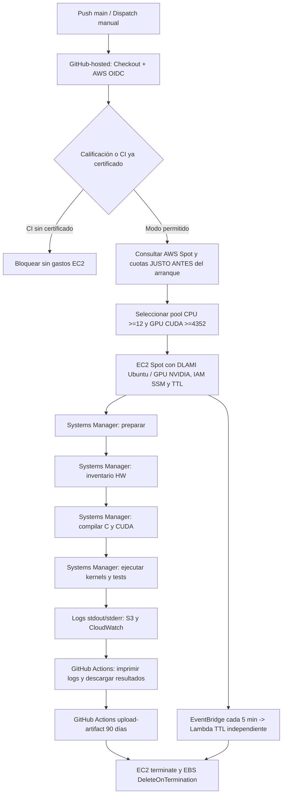

# Implantación de CI C/CUDA sobre EC2 Spot AWS — SSM + GitHub Actions

Fecha: 2026-11-21. **Estado: artefactos IaC/CI preparados; despliegue, permisos OIDC en GitHub y pruebas GPU reales pendientes.**

El flujo automatizado se activa al hacer **push sobre main**, pero solo si se configura expresamente la variable de repositorio `AWS_CUDA_ENABLED=true` y se aprueban las máquinas certificadas. La calificación manual se ejecuta por `workflow_dispatch` con `AWS_CUDA_PROBE_ENABLED=true`.

## Arquitectura implementada



**Importante:** en esta fase GitHub Actions usa un runner alojado por GitHub como **controlador**; la compilación y ejecución se llevan a cabo **en EC2 mediante SSM Run Command**. Por ello no se registra automáticamente una EC2 como runner self-hosted nativo. Esto proporciona trazabilidad y artefactos dentro de Actions sin token de administración de runners; el registro self-hosted JIT puede añadirse posteriormente como adaptación separada si se necesita explícitamente.

## 1. Preparación de AWS (una sola vez)

La cuenta consultada el 21/11/2026 tenía una VPC predeterminada y subredes públicas en Oregón, cuota G/VT Spot de 126 vCPU, y la AMI NVIDIA Ubuntu 22.04 del 13/11/2026 estaba disponible. Son comprobaciones fechadas: verificarlas de nuevo antes de implantar.

Desplegar desde un terminal seguro con AWS CLI y permisos de CloudFormation/IAM. **Revisar la plantilla antes de ejecutar.** No se almacenan IDs de cuentas ni contraseñas en el repositorio.

```bash
export AWS_REGION=us-west-2
aws sts get-caller-identity
VPC_ID="$(aws ec2 describe-vpcs --region "$AWS_REGION" \
  --filters Name=is-default,Values=true --query 'Vpcs[0].VpcId' --output text)"
test -n "$VPC_ID" && test "$VPC_ID" != "None"
aws cloudformation validate-template --region "$AWS_REGION" \
  --template-body file://infrastructure/cloudformation/gpu-ci-base.json
aws cloudformation deploy \
  --region "$AWS_REGION" \
  --stack-name prueba-cuda-ci \
  --template-file infrastructure/cloudformation/gpu-ci-base.json \
  --capabilities CAPABILITY_NAMED_IAM \
  --parameter-overrides VpcId="$VPC_ID" GitHubRepo=skyirim/prueba-cuda
aws cloudformation describe-stacks --region "$AWS_REGION" \
  --stack-name prueba-cuda-ci --query 'Stacks[0].Outputs'
```

La plantilla incluye IAM OIDC GitHub limitado a `repo:skyirim/prueba-cuda:ref:refs/heads/main`, rol para el controlador, perfil de instancia EC2 SSM, S3 privado cifrado con caducidad de objetos tras 7 días, CloudWatch (7 días), SG sin acceso entrante y **watchdog de EC2 cada 5 minutos**. No crea una instancia GPU persistente; puede generar costes menores por almacenamiento, logs y Lambda/EventBridge. **No contiene un presupuesto mensual obligatorio**: la cuota Spot y límite por ejecución no son límites mensuales de facturación.

Si ya existe el proveedor de identidad OIDC de GitHub en esa cuenta, pasar `ExistingOidcArn=arn:aws:iam::<account>:oidc-provider/token.actions.githubusercontent.com` y CloudFormation no creará otro.

## 2. Configurar Variables de GitHub Actions

En GitHub → repositorio → Settings → Secrets and variables → Actions → Variables (no es necesario almacenar claves AWS de larga duración):

| Nombre | Valor |
| --- | --- |
| `AWS_GPU_REGION` | `us-west-2` |
| `AWS_GPU_ROLE_ARN` | Output `GithubRoleArn` de la pila |
| `AWS_GPU_S3_BUCKET` | Output `BucketName` |
| `AWS_GPU_INSTANCE_PROFILE` | Output `InstanceProfileName` |
| `AWS_GPU_SECURITY_GROUP` | Output `SecurityGroupId` |
| `AWS_GPU_VPC_ID` | VPC_ID de la pila |
| `AWS_GPU_LOG_GROUP` | Output `SsmLogGroup` |
| `AWS_CUDA_PROBE_ENABLED` | `false` inicialmente |
| `AWS_CUDA_ENABLED` | `false` inicialmente |

La confianza AWS OIDC usa audiencia `sts.amazonaws.com`, sin credenciales permanentes; `aws-actions/configure-aws-credentials` está fijada a un SHA de release. No dar permisos de OIDC desde PR de forks. El workflow se limita a `main`.

## 3. Calificar la imagen real (solo ejecución manual)

1. Revisar `config/probe-gpu-pools.json` (familias, zonas, AMI oficial y techo).
2. Confirmar presupuesto, conectividad a S3/SSM y que los permisos AWS de la pila están activos.
3. Cambiar **únicamente** `AWS_CUDA_PROBE_ENABLED=true`. Mantener `AWS_CUDA_ENABLED=false`.
4. GitHub → Actions → `AWS GPU C CUDA` → Run workflow → `qualify`.
5. El sistema descubre AMI y subredes en AWS, comprueba recursos mínimos, consulta Spot **ahora** y selecciona la oferta elegible de menor coste con límite **1,50 USD/h** (techo ajustable mediante PR revisado).
6. EC2 arranca con SSM. El job registra cada fase: preparación, inventario CPU/GPU, compilación y ejecución. Un fallo se refleja en Actions y en stdout/stderr. Se conservan también en S3/CloudWatch. La VM se termina al completar o fallar; Lambda TTL protege si muere el controlador.
7. Descargar desde GitHub Actions `aws-gpu-<run>-<attempt>`: `state.json`, registros de cada paso y `results.tar.gz`.
8. Registrar los valores realmente observados, si existe `nvcc`, compatibilidad CUDA, VRAM y pruebas, asociándolos a la AMI exacta.
9. Ejecutar **también** las pruebas en la RTX 2080 Ti del equipo UCAM (no hay acceso automático desde GitHub a ese servidor). Solo entonces marcar `config/hardware-base.json` como `VERIFIED`, completar `evidence/validated-inventory.json` y aprobar mediante PR uno o varios pools en `config/approved-gpu-pools.json`. No falsear los flags de aprobación.

**La calificación de AWS por sí sola no garantiza que cualquier programa C/CUDA funcione en UCAM**: compilación para `sm_75`, API disponibles, uso de memoria y ejecución de programas representativos deben probarse.

## 4. CI automática por cada push

Una vez aprobada la AMI, la portabilidad y los pools, poner `AWS_CUDA_ENABLED=true`. A partir de entonces cada push en `main` lanzará un job GitHub-hosted que consultará Spot y cuota en el momento, pedirá EC2, ejecutará C/CUDA y publicará logs y artefactos.

Cada oferta se vuelve a consultar para cada nueva instancia. Los precios documentados nunca se utilizan para lanzar. Si el proveedor devuelve insuficiencia Spot, se evalúan otras ofertas compatibles y se respeta el techo de tarifa.

```text
Actions run
  Checkout fuente del commit
  AWS OIDC
  Subir fuentes S3
  EC2 Spot: preparar          -> stdout/stderr
  EC2 Spot: inventario CPU/GPU -> stdout/stderr
  EC2 Spot: compilar GCC/nvcc  -> stdout/stderr
  EC2 Spot: ejecutar          -> stdout/stderr y código de salida
  EC2 Spot: archivar          -> resultados
  Terminar EC2 / EBS
  upload-artifact (siempre, incluso con error)
```

El archivo `Makefile` siempre compila y ejecuta ejemplos C y CUDA. Además, cada archivo `programs/c/*.c` y `programs/cuda/*.cu` se compila como programa independiente con su `main()` y se ejecuta (máximo 120 s por binario). **Los proyectos multifichero requieren objetivos concretos en el Makefile y cobertura en `test`.** No se deben ejecutar arbitrariamente scripts de PRs no autorizados.

## 5. Conservación y consulta de registros

- **GitHub Actions**: stdout/stderr de cada comando SSM se recupera íntegro desde S3 y se imprime en grupos del job; códigos de salida no nulos propagan fallo a GitHub.
- **GitHub Artifacts**: `artifacts/aws-gpu/ssm/<etapa>/` contiene salidas originales, `result.json`, `state.json`, `error.txt` y `results.tar.gz` con binarios/datos de prueba. Retención solicitada: **90 días**, sujeta a los límites del plan y la configuración de GitHub.
- **AWS S3**: objetos `runs/<run>/<attempt>/` conservados temporalmente (lifecycle a 7 días), incluso si GitHub se desconecta antes de descargarlos.
- **CloudWatch Logs**: registro SSM con retención 7 días y posibilidad de comprobar fallos previos a la publicación S3.
- **Diagnóstico**: si EC2 no llega a registrarse en SSM, el controlador falla y termina la máquina; el watcher se encarga del cierre si la ejecución desaparece. El registro de arranque EC2 y cloud-init necesita inspección adicional cuando SSM nunca llega a arrancar.

GitHub no ofrece retención indefinida gratuita de artifacts; para archivado permanente se necesita estrategia explícita externa o descargar antes del vencimiento.

## 6. Coste y seguridad

- AWS GPU solo al hacer push en `main` con activación expresa, o calificación manual aprobada.
- Consulta fresca de Spot por AZ y familia; techo actual 1,50 USD/h, **no incluye EBS, IPv4 pública, CloudWatch, S3 ni reintentos**. Los precios pueden cambiar.
- Una sola ejecución por repositorio a la vez (concurrency de Actions); TTL de EC2 35 min para calificar, 70 min para CI. Un evento de push repetido puede generar más ejecuciones y costes, **no existe un tope mensual absoluto**.
- EC2 tiene IP pública únicamente para acceso saliente a SSM y S3; **ningún puerto de entrada abierto**, incluido SSH. Para acceso interactivo usar SSM Session Manager con una identidad AWS autorizada; si debe usarse protocolo SSH, configurar túnel SSH sobre SSM con permisos y clave pública adecuados, sin abrir 22 a Internet.
- No almacenar PAT, claves SSH, secretos ni credenciales dentro de GitHub, UserData o S3. Los roles usan IAM y credenciales temporales OIDC.

## 7. Fallos y recuperación

| Incidencia | Resultado esperado |
| --- | --- |
| Sin aprobación o AMI no certificada | CI se omite o falla cerrada, sin EC2 |
| No existe cuota GPU/Spot compatible | Fallo del job, motivo visible |
| Spot sin capacidad | Reconsultar las ofertas aprobadas antes de reintentar |
| SSM no registra EC2 | Fallo controlado, terminal EC2, watchdog de respaldo |
| GCC o nvcc falla | stdout/stderr SSM completos, job GitHub error y artifact |
| Kernel CUDA devuelve error | fallo reflejado por make test y GitHub |
| GitHub Actions cancelado inesperadamente | watchdog de AWS termina EC2 al vencer TTL |
| Error al terminar EC2 | aviso de limpieza + watchdog con tag ExpireAtEpoch |
| Error de subida del artefacto a GitHub | copia temporal S3/CloudWatch hasta 7 días |

## 8. Control de calidad

```bash
python3 scripts/check_repo.py
python3 -m unittest discover -s tests -v
aws cloudformation validate-template --region us-west-2 \
  --template-body file://infrastructure/cloudformation/gpu-ci-base.json
```

Documentación del diseño original para runners JIT: [docs/arquitectura.md](arquitectura.md). En esta implementación el modo SSM **no requiere GitHub App ni token de registro de self-hosted runner**. La variante nativa self-hosted debe construirse y validarse por separado.

### Acceso saliente y coste

Para evitar coste fijo de interfaces VPC endpoints, el grupo de seguridad no tiene entradas y permite únicamente conexiones salientes TCP/443 a servicios públicos de AWS y repositorios HTTPS de Ubuntu. No es filtrado por nombres de dominio; los accesos se restringen por protocolo y por el código de bootstrap verificado. Si se requiere **restricción también por destino**, desplegar SSM, SSMMessages, EC2Messages y CloudWatch por VPC endpoints y S3 gateway endpoint, usando AMI prebakeada y control de egress; estos endpoints de interfaz pueden suponer cargos horarios permanentes. Queda prohibido describir el modo económico como filtrado por dominio o por destino.


## Actualización de implantación 21/11/2026: AWS en estado bloqueado

La pila CloudFormation **prueba-cuda-ci** fue creada correctamente en us-west-2 y AWS confirmó CREATE_COMPLETE con salidas para BucketName, GithubRoleArn, InstanceProfileName, SecurityGroupId, SsmLogGroup y WatchdogFunction. No son credenciales y deben consultarse en el propio entorno AWS para configurar GitHub.

La prueba real de calificación de una instancia gr6.8xlarge (NVIDIA L4) fue **rechazada por EC2 RunInstances**: error **Blocked — This account is currently blocked and not recognized as a valid account**. No se creó la instancia. La posterior consulta DescribeInstances filtrada por Project=prueba-cuda no detectó ninguna EC2 del proyecto.

Por ello la infraestructura base sí está desplegada, pero la funcionalidad GPU CI está **bloqueada y sin pruebas reales**. No activar variables de GPU en GitHub hasta que [AWS Support resuelva el bloqueo](https://support.console.aws.amazon.com/support/home?region=us-east-1#/case/create?issueType=customer-service&serviceCode=account-management&categoryCode=account-verification), se configure la confianza OIDC en GitHub Actions con las salidas de CloudFormation y se superen calificación AMI y portabilidad UCAM. Seguimiento en [GitHub Issue #7](https://github.com/skyirim/prueba-cuda/issues/7).

El intento rechazado aplicó límite Spot de 0,60 USD/h y TTL 20 minutos, pero nunca comenzó a facturar una EC2 porque RunInstances no la creó. La pila base (S3, CloudWatch, EventBridge/Lambda) puede implicar costes menores propios aunque no existan máquinas GPU.
